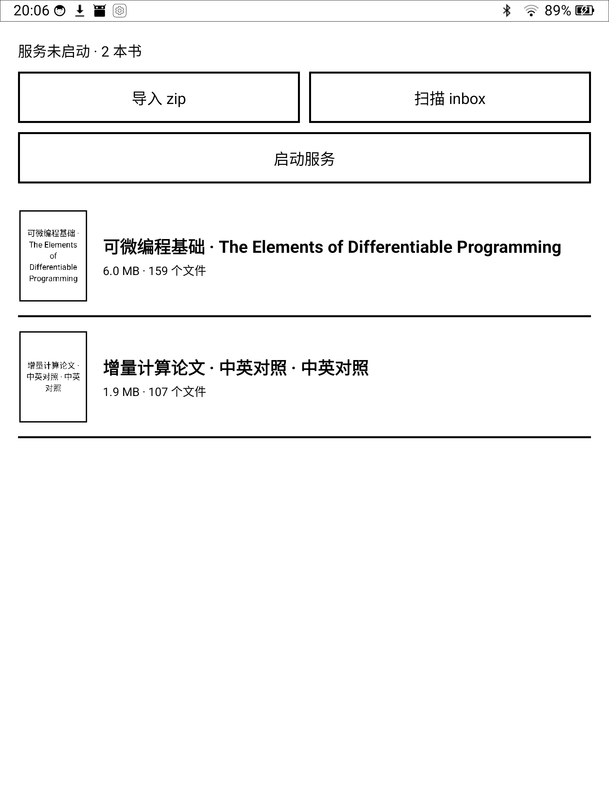

# zipshelf

**把「一个 zip 里的静态网站」当书读。** Android 电子墨水屏阅读容器：导入 zip → 本地起 HTTP 服务 → 用浏览器（EinkBro）打开。

*An e-ink friendly container that serves a static website from a zip file — locally, with no extraction.*

[](https://developer.android.com)  



## 为什么

EPUB 对公式的支持很差：多数阅读器不解析 MathML，回退成纯文本；KaTeX/MathJax 需要 JS，阅读器不带；把每个公式存成图片，放大就糊。

于是换个交付形态：**产出端把书渲染成纯静态、纯黑白的 HTML**（KaTeX 在构建期把公式排成真实文本，可选中、可缩放），
打成一个 zip；这个 App 负责把它当书读——不解压、不解析，只在本机起一个 HTTP 服务，把字节原样喂给浏览器。

## 特性

- **零解压**：zip 里的 deflate 数据流直接包成 gzip 转发给浏览器，App 侧不解压、不整包读入、不 mmap
- **书架**：标题取 `<title>`，封面取 `cover.png` / `og:image`，没有就自动生成 1-bit 标题卡
- **服务控制**：书架上有「启动/停止服务」+ 状态行，通知栏也能停
- **纯黑白 UI**：整屏灰阶像素 0.5%（只剩文字抗锯齿），按钮/对话框/分隔线全部纯黑纯白
- **单端口多书**：所有书共用 `127.0.0.1:8787`，按 `/books/{id}/` 前缀隔离
- **体积小**：纯 Java + framework API，无 androidx / Compose / 第三方 HTTP 库，APK ≈ 60 KB
- **正文用系统级思源宋 Medium**：字体由 Magisk 模块装进系统（[docs/font.md](docs/font.md)），
  书里只写字体族名，不用 `@font-face`、不占 APK、不逐本打包；没装模块时自动回退系统宋体。
  真机实测：400/500/700 三档墨迹 8.38% / 9.69% / 12.77%（500 是真的 Medium，非合成加粗）

## 怎么用

1. 装 APK（自己签名的 debug 包即可）
2. 灌书，三种方式：
   - App 里点「导入 zip」
   - 把 zip 放进 `/sdcard/Android/data/moe.mgt.zipshelf/files/inbox`，回 App 自动导入
   - `adb push` 到设备后用 `run-as` 拷进 `files/inbox`
3. 点书 → 自动起服务并跳 EinkBro

## 仓库结构

```
android/                       Android App（Kotlin 都不用，纯 Java + framework API）
skills/webshelf-book/          「怎么做这种书」的 skill：格式契约、CSS 规范、模板、自检与打包脚本
docs/design.md                 设计文档：实测数据、决策记录、HTTP 规格、已知限制
docs/font.md                   系统字体方案：思源宋 Medium 的 Magisk 模块与回滚
tools/make_font_module.py      生成上述 Magisk 模块（字体 + 只插入一个 family）
docs/screenshots/              截图
```

### 做书的话看这里

`skills/webshelf-book/` 是给 agent（或人）用的完整规范：

```
SKILL.md                五条硬契约、公式方案、打包与自检流程
references/css.md       版式规范（--measure 43rem / 行高 1.62 / 只有 #000 和 #fff）
references/format.md    zip 契约、URL 布局、为什么必须相对路径、为什么不需要「无压缩 zip」
templates/              直接可用的页面骨架 + style.css + KaTeX 资源 + 示例封面
scripts/check_book.py   自检：绝对路径 / 非黑白颜色 / 缺失引用 / 体积分布
scripts/pack_book.py    目录 → 确定性 zip
scripts/render_math.mjs TeX → KaTeX HTML（构建期渲染，无运行时 JS）
```

把它拷进 `~/.agents/skills/`（或你的 skills 目录）即可被 agent 自动加载。

## 构建

需要 JDK 17、Android SDK 35。

```bash
cd android
./gradlew :app:testDebugUnitTest :app:assembleDebug
# 产物：android/app/build/outputs/apk/debug/app-debug.apk
```

`android/keystore/debug.jks` 是可选的本地签名密钥（已在 `.gitignore` 里）；不存在时自动退回
AGP 默认的 debug 签名。如果 `~/.gradle` 不可写（沙箱 / CI），把 `GRADLE_USER_HOME` 指到任意可写目录：

```bash
export GRADLE_USER_HOME=$PWD/../.gradle-home
export GRADLE_RO_DEP_CACHE=$HOME/.gradle/caches   # 复用已有依赖缓存，可省掉下载
```

## 测试

```bash
cd android && ./gradlew :app:testDebugUnitTest     # 22 项单元测试
```

覆盖：zip 中央目录解析（与 `java.util.zip` 逐条目比对）、gzip 帧往返哈希、Range/416/304/400、
404 页路径改写、keep-alive 双请求、嵌套根目录识别。

真机端到端（把手机上的服务映射到本机端口）：

```bash
adb forward tcp:8899 tcp:8787
curl -s http://127.0.0.1:8899/healthz
curl -s -D - -o /dev/null -H 'Accept-Encoding: gzip' http://127.0.0.1:8899/books/<id>/ch0006.html
```

## 已知限制

- 服务被系统重启后的自愈逻辑已实现，但未在真机上实测（设备无 root，无法制造真实重启）
- HTTP 服务是「一连接一线程 + 8 线程池」，队列无界；慢客户端阻塞在 `write` 时不受读超时保护
- 书 id 是 UUID，删了重导会变 → 旧链接失效
- 同机其他 App 可以访问 `127.0.0.1:8787` 读到书内容（没做 token）

## 许可

MIT。模板里的 KaTeX 字体与 CSS 来自 [KaTeX](https://katex.org)（MIT）。

EinkBro 是 [plateaukao/EinkBro](https://github.com/plateaukao/EinkBro)，本项目只是通过 Intent 调起它，没有包含它的代码。
